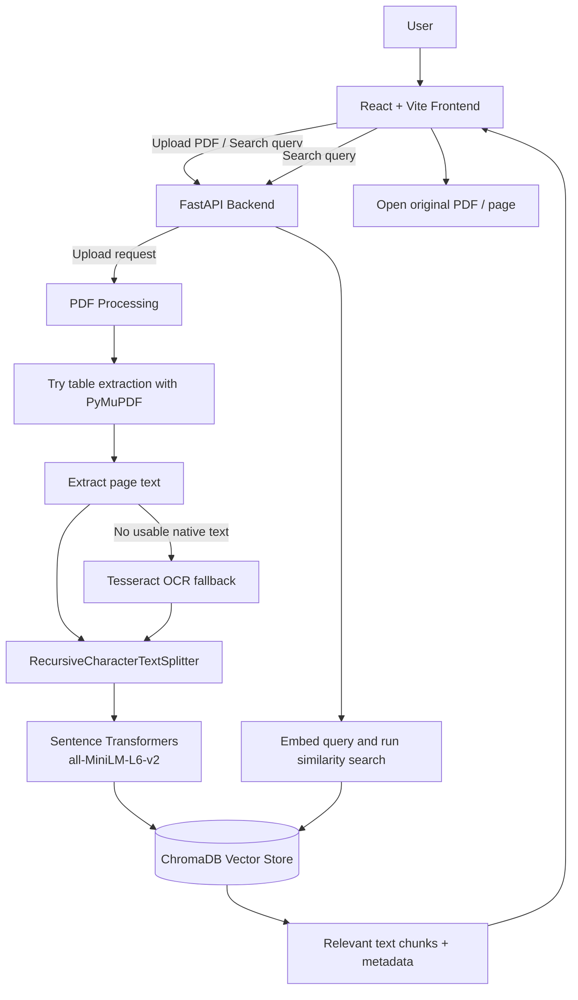

# DocuMind AI — Document Intelligence Portal

> An AI-powered document search portal that lets users upload PDF files and retrieve relevant information using natural-language queries.

## Table of Contents

- [Project Overview](#project-overview)
- [Features](#features)
- [Architecture](#architecture)
- [Document Processing and Search Flow](#document-processing-and-search-flow)
- [Technology Stack](#technology-stack)
- [Project Structure](#project-structure)
- [Requirements](#requirements)
- [Setup and Run Locally](#setup-and-run-locally)
- [How to Use the Application](#how-to-use-the-application)
- [Testing and Verification](#testing-and-verification)
- [API Overview](#api-overview)
- [Known Limitations](#known-limitations)
- [Security and Sharing Notes](#security-and-sharing-notes)
- [Troubleshooting](#troubleshooting)

---

## Project Overview

DocuMind AI is a document-intelligence web application built to make long PDF documents easier to search. Instead of manually reading every page, a user can upload a PDF and ask a natural-language question or search phrase. The backend processes the document, stores searchable text representations, and retrieves relevant passages with their source document and page number.

The project was tested with two PDF files:

- `company_document.pdf` — 120 pages
- `tata_tender.pdf`

The frontend displays matching passages as result cards with the document name, page number, extracted text, and links to view/open the original PDF.

**Important:** This project performs semantic retrieval. Search results are relevant passages, not guaranteed answers generated by an LLM. Verify important details in the original PDF.

## Features

- PDF upload through the web interface.
- PDF text extraction with PyMuPDF.
- Table extraction attempted before normal page-text extraction.
- OCR fallback using Tesseract when native text extraction does not return usable text.
- Text chunking using LangChain's `RecursiveCharacterTextSplitter`.
- Sentence embeddings generated with the `all-MiniLM-L6-v2` Sentence Transformers model.
- Vector storage and similarity search using ChromaDB.
- Search results include source document and page metadata.
- Frontend result cards provide PDF viewing/opening controls.
- FastAPI backend with interactive API documentation.
- React + Vite frontend.

## Architecture

### High-level architecture



### Component responsibilities

| Component | Responsibility |
|---|---|
| React + Vite frontend | Uploads PDFs, sends search queries, and displays result cards. |
| FastAPI backend | Exposes application endpoints and coordinates document upload and search. |
| PyMuPDF | Extracts PDF page text and attempts table extraction. |
| Tesseract OCR | Fallback for pages where native text extraction does not provide usable text; OCR availability depends on local installation and PATH configuration. |
| RecursiveCharacterTextSplitter | Splits extracted text into overlapping chunks. |
| Sentence Transformers | Converts text chunks and search queries into embedding vectors. |
| ChromaDB | Stores vectors and associated text/metadata for similarity search. |

## Document Processing and Search Flow

### A. When a PDF is uploaded

1. The user selects a PDF in the frontend.
2. The frontend sends it to the FastAPI upload endpoint.
3. The backend processes the PDF page by page.
4. It first attempts to extract tables and format rows as text. If that does not provide table content, it falls back to regular page-text extraction.
5. If native text extraction produces no usable text, the OCR fallback may be used.
6. The extracted text is split into chunks using a chunk size of **800 characters** and an overlap of **150 characters**.
7. Sentence Transformers generates embeddings for the chunks.
8. The chunks, vectors, and relevant metadata are stored in ChromaDB.
9. The API returns a processing status, page count, and number of chunks created.

### B. When a user searches

1. The user enters a natural-language query, for example `printing and stationery` or `tender deadline`.
2. The frontend sends the query to the FastAPI search endpoint.
3. The backend embeds the query and performs similarity search against ChromaDB.
4. The backend returns the best-matching chunks with document and page metadata.
5. The frontend renders the results as cards.
6. The user can open/view the source PDF and verify the passage in context.

## Technology Stack

| Layer | Technology |
|---|---|
| Frontend | React, Vite, JavaScript, CSS |
| Backend API | Python, FastAPI |
| PDF processing | PyMuPDF |
| OCR fallback | Tesseract OCR |
| Text splitting | LangChain `RecursiveCharacterTextSplitter` |
| Embeddings | Sentence Transformers — `all-MiniLM-L6-v2` |
| Vector database | ChromaDB |
| API testing | FastAPI Swagger UI; browser-based frontend testing |
| Version control (if configured) | Git / GitHub |

## Project Structure

The exact files may differ slightly depending on your local version. The project has a `backend` folder and a `frontend` folder.

```text
document-intelligence-portal/
├── backend/
│   ├── main.py              # FastAPI application and API routes
│   ├── rag.py               # PDF extraction, chunking, embeddings, vector search
│   ├── requirements.txt     # Python dependencies (if present)
│   └── ...                  # Other backend files / local data
├── frontend/
│   ├── src/                 # React components and application code
│   ├── package.json         # Frontend dependencies and scripts
│   ├── index.html
│   └── ...                  # Vite configuration and assets
├── README.md
└── ...
```

Do not commit virtual environments, `node_modules`, private credentials, or local-only files.

## Requirements

Install the following before running the project:

- Python 3.10 or a compatible version supported by the backend dependencies.
- Node.js and npm.
- Tesseract OCR installed locally if you want OCR fallback to work.
- Git (optional, for version control).

The first run may download the Sentence Transformers model. Internet access may be required for that initial download.

## Setup and Run Locally

Commands below use Windows PowerShell. Open **two separate terminals**: one for the backend and one for the frontend.

### 1. Start the backend

Open PowerShell and run:

```powershell
cd "C:\Users\saada\OneDrive\Desktop\document-intelligence-portal\backend"
```

Create and activate a virtual environment if you do not already have one:

```powershell
python -m venv venv
.\venv\Scripts\Activate.ps1
```

If PowerShell blocks activation, you can temporarily allow it for the current terminal:

```powershell
Set-ExecutionPolicy -Scope Process -ExecutionPolicy Bypass
.\venv\Scripts\Activate.ps1
```

Install dependencies if a `requirements.txt` file exists:

```powershell
pip install -r requirements.txt
```

Run the API server (assuming the FastAPI application object in `main.py` is named `app`):

```powershell
uvicorn main:app --reload
```

Expected local addresses:

- API: `http://127.0.0.1:8000`
- Interactive API docs: `http://127.0.0.1:8000/docs`
- Health endpoint, if enabled: `http://127.0.0.1:8000/health`

Keep this terminal open while using the application.

### 2. Start the frontend

Open a **second** PowerShell terminal:

```powershell
cd "C:\Users\saada\OneDrive\Desktop\document-intelligence-portal\frontend"
npm install
npm run dev
```

Vite normally prints the local frontend URL. In the tested setup it was:

```text
http://localhost:5173/
```

Keep this terminal open too.

> If the frontend API base URL is configured in a file or environment variable, make sure it points to the backend running at `http://127.0.0.1:8000`. Do not publish private environment values.

## How to Use the Application

1. Open `http://localhost:5173/` in your browser.
2. Use **Upload PDF** to select a PDF file.
3. Wait for the upload/processing request to finish successfully.
4. Enter a search phrase in the search field, such as:
   - `printing and stationery`
   - `tender deadline`
   - `eligibility criteria`
   - `payment terms`
5. Submit the search.
6. Review the result cards. Each result should show the source PDF, page number, extracted passage, and PDF viewing/opening control.
7. Open the source PDF and confirm the relevant passage in its surrounding context.

## Testing and Verification

The following checks were performed in the local development environment.

### 1. Backend syntax check

Command run from the backend directory:

```powershell
python -m py_compile rag.py
```

**Observed result:** No output was produced, indicating that Python compilation completed without reporting a syntax error.

### 2. PDF upload / indexing check

The file `company_document.pdf` was uploaded through the API. The API returned HTTP success and this response:

```json
{
  "message": "PDF processed successfully.",
  "document": "company_document.pdf",
  "pages_processed": 120,
  "chunks_created": 223
}
```

### 3. Search API check

The search endpoint was tested with:

```text
/search?q=printing%20and%20stationery&top_k=3
```

It returned relevant content from `company_document.pdf`, including a result on page 26 about printing and stationery. The response included the extracted text, document name, page number, and a similarity distance.

### 4. Frontend search check

The frontend was tested using these queries:

- `printing and stationery`
- `tender deadline`

Observed results included passages from `company_document.pdf` and `tata_tender.pdf`, with source names and page numbers visible in the interface.

### 5. PDF navigation check

The user reported completing the final PDF navigation test using the result's **View PDF** / **Open original document** control. The test was marked complete in the conversation. The exact target page and browser behavior were not independently inspected, so verify again after any code changes.

### Test observations / known limitations

- Some extracted PDF text has imperfect spacing, punctuation, or table layout. For example, words may appear split or commas may be misplaced.
- Similarity search can return multiple chunks from the same page.
- A semantically related result is not necessarily a complete answer to the query; inspect the original document for important decisions.
- The project was tested locally. Cloud deployment, multi-user behavior, authentication, and production-scale performance have not been verified here.

## API Overview

The following endpoints were identified in the project context. Confirm the current definitions in `backend/main.py` or at `/docs` if your local code has changed.

| Method | Endpoint | Purpose |
|---|---|---|
| `GET` | `/` | Application/root endpoint, if configured |
| `GET` | `/health` | Health check |
| `GET` | `/documents` | List processed/available documents |
| `POST` | `/upload` | Upload and process a PDF |
| `GET` | `/search` | Search indexed content using a query and result limit |

Open `http://127.0.0.1:8000/docs` to inspect the actual request parameters and try the endpoints interactively.

## Known Limitations

- PDF extraction quality depends on the source PDF's layout and whether its text is selectable.
- Table-heavy PDFs may not retain their original visual layout after extraction.
- OCR fallback requires Tesseract to be installed and configured correctly.
- Semantic search ranks matching passages; it does not guarantee a factually complete answer.
- The README describes the tested local setup; hosting and deployment still need separate configuration.

## Security and Sharing Notes

Before sharing the repository or ZIP:

- Never commit `.env` files, API keys, tokens, passwords, or private credentials.
- Do not upload `venv/`, `node_modules/`, caches, or unnecessary generated data.
- Confirm whether the PDFs are permitted to be redistributed. If not, provide small public/sample documents or instructions for uploading the files locally.
- If ChromaDB's local persistent directory contains document text or vectors derived from private files, review it before sharing.
- Avoid committing large PDF files unless you have permission and intentionally want to include them.

## Troubleshooting

### Backend command `uvicorn` is not found

Activate the virtual environment and install dependencies:

```powershell
python -m pip install uvicorn fastapi
```

Then retry:

```powershell
uvicorn main:app --reload
```

### Frontend cannot reach the backend

- Confirm the backend is running at `http://127.0.0.1:8000`.
- Check the frontend's configured API base URL.
- Inspect the browser developer console and backend terminal for errors.
- Check CORS configuration if the browser reports a cross-origin request error.

### OCR does not work

- Confirm Tesseract OCR is installed.
- Confirm its executable is available on PATH, or check the backend's configured Tesseract path.
- Restart the backend terminal after changing PATH.

### Search results look poorly formatted

This can happen with multi-column or table-based PDFs. Check the original PDF page. Current extraction attempts table extraction first and then falls back to regular text extraction and OCR where needed.

---

## Project Status

**Local development status:** Core PDF upload, indexing, semantic search, and frontend result display have been exercised with the sample documents described above.

**Not yet established:** Public deployment, production hardening, authentication/authorization, multi-user isolation, and performance under load.

---

## Author

Add your name, contact details, and portfolio/GitHub links here before publishing the repository.
